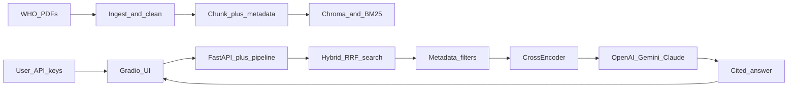

# NCD Guideline Tutor

**[Try the live demo on Hugging Face](https://huggingface.co/spaces/sudhirshivaram/ncd-guideline-tutor)** — bring your own LLM API key.

A production-style **Retrieval-Augmented Generation (RAG)** assistant for **noncommunicable disease (NCD)** care in primary health settings. The app answers protocol questions from official **WHO** guidelines and returns **page-level citations**.

This is **clinical decision support**, not a patient chatbot and not a substitute for clinical judgment.

## Business problem

Primary-care teams need reliable access to hypertension and type 2 diabetes treatment guidance. This focused corpus contains **three WHO PDFs**: HEARTS treatment protocols, HEARTS-D, and the adult hypertension guideline. The tutor retrieves relevant passages, reranks them, and generates answers with source references.

Typical questions:

- When should pharmacological treatment for adult hypertension start?
- What is the HEARTS-D first-line treatment for type 2 diabetes?
- What does WHO recommend for combination therapy when starting hypertension treatment?
- When is metformin contraindicated in the HEARTS-D diabetes protocol?

## Architecture



End-to-end flow: **Knowledge sources → ingest → cleaning/chunking → metadata → embeddings/indexing → hybrid retrieval → filters → rerank → LLM → citations → Gradio chat UI.**

The Gradio UI is mounted at `/` on FastAPI and calls `stream_answer` in-process. REST endpoints (`/api/health`, `/api/filters`, `/api/chat`, `/api/eval/run`) remain available for scripts.

See [WALKTHROUGH.md](WALKTHROUGH.md) for module-level design trade-offs.

## Knowledge sources

Three WHO clinical protocol resources (CC BY-NC-SA 3.0 IGO):

| File | Document |
| --- | --- |
| `data/WHO-NMH-NVI-18.2-eng.pdf` | HEARTS: evidence-based treatment protocols (2018) |
| `data/WHO-UCN-NCD-20.1-eng.pdf` | HEARTS-D: type 2 diabetes (2020) |
| `data/9789240033986-eng.pdf` | Pharmacological treatment of hypertension in adults (2021) |

The corpus excludes WHO PEN, the separate CVD risk-management package, and cancer guides.

## RAG pipeline

1. **Ingest** — PyMuPDF page extraction, repeating header/footer stripping.
2. **Chunk** — page-bounded, heading-aware splits (up to 3200 characters, 600-character overlap within a section). Every chunk cites its own 1-based PDF page; tables spanning pages or long sections can still split.
3. **Metadata** — `doc_id`, year, NCD type, document type, source family, page, section.
4. **Embeddings** — local ONNX `all-MiniLM-L6-v2` (free; no PyTorch; indexing does not need an LLM key).
5. **Indexes** — Chroma (vector) + BM25 (keyword).
6. **Hybrid retrieval** — Reciprocal Rank Fusion of semantic and keyword ranks.
7. **Filters** — NCD type, document, year, doc type (left panel).
8. **Rerank** — local FlashRank MiniLM cross-encoder (`ms-marco-MiniLM-L-12-v2`) on the fused candidates.
9. **Generate** — OpenAI, Gemini, or Claude using the **user’s** API key.
10. **Citations** — source panel with title, page, and snippet below the chat.

### Why hybrid search and reranking

- Vector search catches paraphrases (“BP treatment threshold”).
- BM25 catches exact protocol language and drug names (“gliclazide”, “HEARTS protocol”).
- RRF is a strong default fusion method that does not need a trained score calibrator.
- A cross-encoder is slower but much better at putting the actually relevant paragraph first before the LLM sees it.

Trade-off: local MiniLM (ONNX) is weaker than large embedding APIs, but it keeps the demo under **$0.50** and works on Hugging Face CPU without a multi-gigabyte PyTorch install.

## Setup

Python 3.11+.

```bash
python3.12 -m venv .venv
source .venv/bin/activate
pip install -r requirements.txt

# Build the local search index (downloads MiniLM once, no API key)
cd backend
PYTHONPATH=. python -m app.rag.indexing

# Run the Gradio UI (mounted on FastAPI)
PYTHONPATH=. uvicorn app.main:app --reload --port 8000
```

Open [http://127.0.0.1:8000](http://127.0.0.1:8000). Paste an OpenAI, Gemini, or Anthropic key in the left panel. Keys stay in the browser session and are never written on the server.

## API-key handling

- No keys in git. `.env.example` has paths and model names only.
- The Gradio UI sends the key only for the current request; the server does not persist it.
- REST chat (`POST /api/chat`) still accepts `X-LLM-Provider` and `X-API-Key` for scripting.

Supported providers: **OpenAI**, **Google Gemini**, **Anthropic Claude**. Default cheap models: `gpt-4o-mini`, `gemini-3.5-flash-lite`, `claude-haiku-4-5`.

## Provider validation and testing cost

The adapters support request-scoped credentials, streaming, a 60-second SDK timeout, no automatic retries, and a maximum of 1,200 output tokens. Gemini uses `google-genai` instead of the legacy global configuration API. The default Gemini model is `gemini-3.5-flash-lite`; model access still depends on the user's account.

Offline adapter tests cover history/system messages, streaming, usage extraction, client cleanup, and Gemini key isolation. These do not prove successful authentication or model access. **Gemini live validation passed** for all three demo requests on September 24, 2026 (`gemini-3.5-flash-lite`). API-reported usage totaled **3,794 input tokens and 321 output tokens**, equivalent to **$0.0019407** at the recorded standard list prices (not an invoice measurement). See the [live Gemini report](evals/provider_demo_gemini_live.json). This provider check used the earlier index; its usage totals are historical and were not remeasured after the page-bounded chunking update. OpenAI and Anthropic live validation remain pending their API keys.

Standard text prices checked September 24, 2026, in USD per million tokens:

| Demo model | Input | Output |
| --- | ---: | ---: |
| [gpt-4o-mini](https://developers.openai.com/api/docs/models/gpt-4o-mini) | $0.15 | $0.60 |
| [gemini-3.5-flash-lite](https://ai.google.dev/gemini-api/docs/pricing) | $0.30 | $2.50 |
| [claude-haiku-4-5](https://platform.claude.com/docs/en/about-claude/pricing) | $1.00 | $5.00 |

The demo uses three independent questions (hypertension, diabetes, and an out-of-scope question), five retrieved passages, and a 400-token output cap per request. Local indexing and reranking have no API charge. Offline projection uses actual prompt character lengths divided by four plus a 100-token allowance; this is an approximation, not measured usage or a guaranteed spending cap. The recorded nine-request projection is **$0.016471 total** (three questions per provider). See [offline report](evals/provider_demo_offline.json).

From the project root:

```bash
# No provider calls; retrieve context and calculate a projection.
PYTHONPATH=backend .venv/bin/python -m app.eval.provider_demo --output evals/provider_demo_offline.json

# Set credentials securely in the local shell first; never commit them.
# OPENAI_API_KEY, GOOGLE_API_KEY, ANTHROPIC_API_KEY
# Three requests per selected provider; omit --provider to test all three.
PYTHONPATH=backend .venv/bin/python -m app.eval.provider_demo --live --provider openai --output evals/provider_demo_live.json
```

Live reports use API-reported input/output counts and the dated list rates. Gemini output accounting includes thinking tokens. Missing usage remains unknown rather than zero; missing credentials and failed requests are reported explicitly and make the live command exit unsuccessfully. Success means nonempty streaming text and reported usage, not clinical answer quality. Reports contain demo answers but never credentials or raw provider error bodies. List-price calculations exclude discounts, free tiers, taxes, and unknown charges for interrupted requests; verify actual charges in provider billing dashboards.

## Evaluation

Gold set: [`evals/ncd_gold_set.json`](evals/ncd_gold_set.json) (17 questions: 14 answerable and 3 deliberately unanswerable items).

```bash
cd backend
PYTHONPATH=. python -m app.eval.runner
# optional generation metrics (uses your key)
OPENAI_API_KEY=sk-... PYTHONPATH=. python -m app.eval.runner --generation
```

Metrics (report schema version 2):

- **Document hit rate@5** and **MRR**: whether any acceptable guideline appears in the top five; not recall over every relevant passage.
- Optional **answer/context token overlap** and **question/answer token overlap**: lexical diagnostics, not faithfulness or semantic answer quality.
- **Citation ID precision**: valid unique inline `[n]` references divided by all unique references used in the answer (including invalid IDs).
- **Citation source precision/hit**: compare only used references against acceptable `(doc_id, page)` pairs. Page numbers are 1-based PDF pages. A missing citation scores zero for annotated cases; unannotated cases are `null` and excluded from averages. Each aggregate includes `n_scored` and `n_total`.
- **Unanswerable abstention signal** and **answerable abstention signal**: separate lexical refusal checks. Review the saved full answers to detect refusals followed by invented advice; these are not correctness judgments.

All **14 answerable cases** now have PDF-text-verified page annotations (**17 source references**); the three unanswerable cases intentionally have none. Each annotation includes an evidence excerpt, and source PDF SHA-256 fingerprints detect document changes. These annotations were reviewed by the assistant, not an independent clinical expert. They identify known supporting pages rather than an exhaustive set of valid citations; a hit can support only part of a multi-part question. Source precision measures agreement with these annotations, so valid but unlisted pages can lower it. Citation-location agreement does not prove claim support, and PDF extraction or imperfect heading detection can still affect context quality. Semantic context relevance, groundedness, and answer correctness require further reviewed annotations or judging.

Save the full report, including per-case answers and citations for generation runs:

```bash
cd backend
PYTHONPATH=. python -m app.eval.runner --output ../evals/three_document_retrieval.json
PYTHONPATH=. python -m unittest discover -s tests -v
```

Generation uses the selected provider's environment variable (`OPENAI_API_KEY`, `GOOGLE_API_KEY`, or `ANTHROPIC_API_KEY`). Supply a matching `--model` when selecting a non-OpenAI provider. Explicit `filters` apply consistently to retrieval and generation; the gold set's `ncd_type` field is a descriptive label.

Three-document retrieval baseline: **Document hit rate@5 = 1.0**, **MRR = 0.964** on **14 answerable questions**, using hybrid retrieval and reranking over **560 page-bounded chunks**. Every chunk was checked against text on its cited PDF page. The [saved report](evals/three_document_retrieval.json) includes per-question results and supplies the UI baseline; it is not a live measurement. Rerun evaluation after corpus or retrieval changes. Interpret retrieval scores as “did we surface the right guideline?” Generation lexical scores are comparative, not clinical validation.

## Hugging Face deployment

The [public demo](https://huggingface.co/spaces/sudhirshivaram/ncd-guideline-tutor) runs as a **Gradio Space on CPU Basic**. Open the app, select a provider, enter your own API key, and ask a guideline question. The deployed chat and metadata filters have been manually checked by the project owner.

The Space uses its own `app.py` entry point and Gradio README configuration. This repository also supports local Docker use; its Docker metadata should not overwrite the deployed Space’s Gradio configuration.

### Run the Docker image locally

From this project directory:

```bash
docker build -t ncd-guideline-tutor:local .
docker run --rm -p 127.0.0.1:7860:7860 ncd-guideline-tutor:local
```

Open http://127.0.0.1:7860 and enter your provider key in the UI. No `.env` file or server-side provider key is needed. Stop the container with Ctrl+C.

Docker validation (September 24, 2026): image build succeeded; Gradio, health, and filter endpoints returned HTTP 200; hybrid retrieval and reranking worked with container networking disabled. A separate container with its BM25 file removed rebuilt all 560 chunks and became healthy. No provider credentials were supplied. This validates local Docker behavior, not a public Hugging Face deployment.

The build warms the embedding model by encoding a sample string and caches FlashRank at the same path used at runtime. Local `.env` variants and credential files are excluded from the build context.

## Limitations and next steps

- Not for diagnosing or treating a named patient.
- MiniLM embeddings miss some long-range clinical nuance; a larger embedding model would help.
- Table-heavy WHO pages can still fragment.
- No EHR / FHIR integration, no multilingual UI yet.
- Possible extensions: country-adapted PEN protocols, image/chart parsing, multilingual retrieval, stronger LLM-as-judge evals.

## License

Application code is for portfolio/demo use. WHO source PDFs remain under **CC BY-NC-SA 3.0 IGO**. Do not imply WHO endorsement.

## Runtime readiness and recovery

`/api/health` returns HTTP 200 only when chunk data, BM25, and the configured Chroma collection load successfully and their IDs agree. Missing, empty, unreadable, or inconsistent components return HTTP 503. Validation checks BM25 ordering and corpus size as well as vector IDs; it does not certify retrieval quality or detect every possible form of on-disk corruption.

```bash
cd backend
PYTHONPATH=. python -m app.rag.indexing --check
```

Docker startup validates the entire index, attempts a rebuild if validation fails, and validates again before serving. If rebuilding fails, startup exits rather than serving an incomplete index. Builds leave an `indexes/.building` marker until completion and validation succeed; an interrupted build remains unavailable until a successful rebuild. Run rebuilds with the server stopped and restart afterward; concurrent live rebuilds are not supported. An unreadable Chroma database may require restoring or replacing the damaged index directory before rebuilding.

Semantic/embedding and keyword search errors stop the request; hybrid search does not silently fall back to BM25. Gradio displays the error, REST chat emits an SSE `error` event (the stream's HTTP headers may already be sent), and non-streaming retrieval failures return HTTP 503. An empty successful search remains a valid result. Logs record failure types without query text or API keys.
